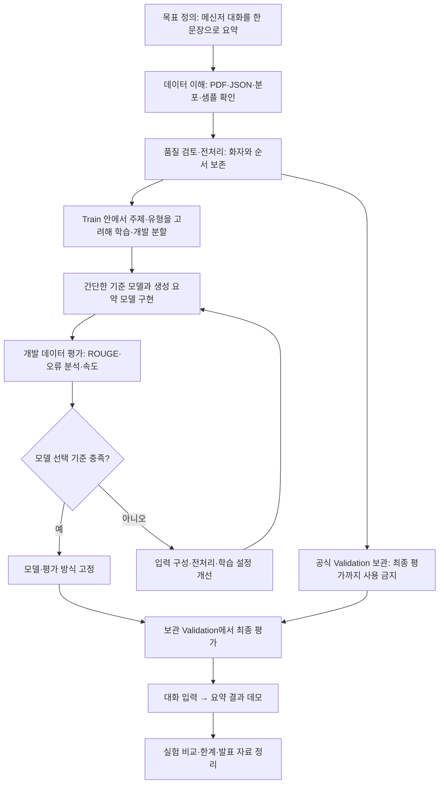

# 한국어 대화 요약 팀프로젝트: 데이터 이해와 진행 흐름

분석일: 2026-09-18. 현재 폴더의 압축 해제된 JSON 18개를 전수 확인했다. 아래 통계는 로컬 파일의 실측값이며, 모델 학습·전처리·데이터 분할은 아직 수행하지 않았다.

## 1. 프로젝트가 해결할 문제

**여러 화자가 주고받은 한국어 메신저 대화를 입력하면 핵심 내용을 한 문장으로 요약하는 서비스**를 만든다.

입력 X는 `body.dialogue`의 화자와 발화, 정답 y는 `body.summary`이다. 요약문은 사람이 작성한 생성 요약이다. 주제와 대화 유형은 분석·평가에 사용하고, 우선 요약 기능을 중심으로 프로젝트 범위를 잡는다. 기간, 팀 인원, GPU 환경에 따라 모델과 구현 범위를 확정한다.

[AI Hub 공식 설명](https://aihub.or.kr/aihubdata/data/view.do?dataSetSn=117)은 총 350,000건의 한국어 대화와 한 문장 생성 요약을 안내한다. 구축 가이드라인은 카카오톡 대화를 수집·정제·비식별화한 데이터임을 설명한다. 실제 회의록이나 전문 상담 데이터에서의 성능은 별도 확인해야 한다.

## 2. 현재 폴더에서 확인한 자료

| 자료 | 확인 내용 |
|---|---|
| `[라벨]한국어대화요약_train/` | 중첩된 같은 이름 폴더 안에 주제별 JSON 9개 |
| `[라벨]한국어대화요약_valid/` | 중첩된 같은 이름 폴더 안에 주제별 JSON 9개 |
| train.zip / valid.zip | 압축 해제본과 중복 집계하지 않음. 압축 파일 내부 동일성은 별도 검사하지 않음 |
| `020.한국어_대화_요약_데이터_구축_가이드라인.pdf` | 30쪽, v3.2 / 2022-05-09. 최종 구조·9개 주제·2개 유형·요약 작성 기준·8:1:1 분할 설명 |
| `20. [요약 데이터 과제] 한국어 대화 요약 데이터.pdf` | 7쪽, 2020년 테크니컬 리포트. 초기 설계·비식별화·구축 과정 설명 |

라벨 파일 안에 대화 원문과 요약문이 모두 있다. 가이드라인도 별도 원천 데이터가 없다고 명시한다. 현재 폴더에는 Test 데이터와 기존 코드·모델이 없다.

초기 리포트는 16개 주제와 질의응답 유형을 설명하지만, 최신 로컬 가이드라인과 실제 파일은 **9개 주제, 일상·토론 2개 유형**이다. 초기 PDF의 JSON 예시를 그대로 파서로 구현하지 않는다. 가이드라인의 예시·표에도 필드 오탈자와 배치 차이가 있어 실제 JSON을 기준으로 한다.

## 3. 실제 JSON 구조

```text
주제별.json
├─ numberOfItems: 해당 파일의 대화 건수
└─ data: 대화 레코드 배열
   ├─ header
   │  ├─ dialogueInfo
   │  │  ├─ dialogueID
   │  │  ├─ numberOfParticipants
   │  │  ├─ numberOfUtterances
   │  │  ├─ numberOfTurns
   │  │  ├─ type
   │  │  └─ topic
   │  └─ participantsInfo[]
   │     ├─ participantID
   │     ├─ gender
   │     ├─ age
   │     └─ residentialProvince
   └─ body
      ├─ dialogue[]
      │  ├─ utteranceID / turnID / participantID
      │  ├─ date / time
      │  └─ utterance
      └─ summary
```

대화 한 건이 학습 샘플 하나다. 발화별로 정답 요약을 복제해서 샘플을 만들지 않는다. `utterance`는 메시지 단위이고, `turnID`는 말차례 단위라서 같은 화자의 연속 메시지 여러 개가 같은 말차례에 속할 수 있다.

입력은 원래 배열 순서를 유지해 `P01: 발화\nP02: 발화`처럼 만든다. `U1, U2, ..., U10`을 문자열로 정렬하면 순서가 잘못된다. 화자 ID는 대화 내부 식별자이며 서로 다른 대화의 P01이 같은 사람이라는 의미는 아니다. 성별·연령·거주지는 기본 모델 입력에 넣지 않는다. 날짜·시간은 필요할 때만 실험 변수로 추가한다.

## 4. 전수 조사 결과

| 구분 | 파일 수 | 대화 수 |
|---|---:|---:|
| Train | 9 | 279,992 |
| Validation | 9 | 35,004 |
| 로컬 합계 | 18 | **314,996** |

공식 전체 규모 350,000건과 현재 로컬 합계는 구분해야 한다. 가이드라인의 8:1:1 분할과 대체로 맞지만, 누락된 파일의 정확한 구성은 현재 자료만으로 확인할 수 없다.

| 주제 | Train | Validation | Train 비율 |
|---|---:|---:|---:|
| 개인 및 관계 | 71,130 | 8,892 | 25.40% |
| 주거와 생활 | 45,179 | 5,648 | 16.14% |
| 여가 생활 | 35,247 | 4,407 | 12.59% |
| 식음료 | 30,184 | 3,773 | 10.78% |
| 상거래(쇼핑) | 26,298 | 3,288 | 9.39% |
| 행사 | 21,338 | 2,668 | 7.62% |
| 일과 직업 | 20,428 | 2,554 | 7.30% |
| 미용과 건강 | 17,069 | 2,134 | 6.10% |
| 시사/교육 | 13,119 | 1,640 | 4.69% |

| 대화 유형 | Train | Validation |
|---|---:|---:|
| 일상 대화 | 278,384 | 34,816 |
| 토론 대화 | 1,608 | 188 |

Train의 99.43%가 일상 대화다. 전체 점수만 보면 토론에서의 약점을 놓칠 수 있어 주제별·유형별 점수를 같이 본다.

| Train 길이 | 평균 | 중앙값 | 95백분위 | 최대 |
|---|---:|---:|---:|---:|
| 발화 수 | 11.27 | 10 | 18 | 30 |
| 말차례 수 | 5.84 | 5 | 9 | 20 |
| 참여자 수 | 2.07 | 2 | 3 | 9 |
| 대화 문자 수 | 130.89 | 118 | 239 | 2,044 |
| 요약 문자 수 | 42.02 | 40 | 69 | 174 |

문자 수는 화자 접두사 없이 발화를 줄바꿈으로 연결한 Unicode 문자 수다. **모델 토큰 수와 다르다.** 최대 입력 길이는 모델 토크나이저로 다시 측정한 뒤 결정하고, 잘리는 샘플 비율을 기록한다. Validation의 참여자 수 최대는 10명이다.

## 5. 품질 점검과 전처리 원칙

| 점검 항목 | 결과 |
|---|---|
| `numberOfItems`와 실제 레코드 수 | 18개 파일 모두 일치 |
| 빈 대화 전체 / 빈 정답 요약 | Train·Validation 모두 0건 |
| 빈 발화 포함 대화 | Train 2건, Validation 0건 |
| 참여자 수 / 발화 수 메타 정보 불일치 | 모두 0건 |
| 말차례 수와 고유 `turnID` 수 불일치 | Train 1건 |
| 등록되지 않은 화자 ID / 발화 ID 순서 문제 | 모두 0건 |
| 8개 미만 발화 / 4개 미만 말차례 | 모두 0건 |
| 동일 split 내 중복 ID / 정규화 원문 | 모두 0건 |
| Train·Validation 간 중복 ID / 정규화 원문 | 모두 0건 |

중복 검사는 발화별 공백을 정규화하고 발화 경계·순서를 유지한 원문의 SHA-256 해시를 비교했다. 화자·시간·요약은 해시에 넣지 않았다. 부분적으로 겹치는 대화, 유사한 대화, 같은 원천 대화에서 잘린 구간은 검사하지 않았다. 구조 검사는 주요 필드와 수량에 대한 것으로 전체 JSON Schema 검증은 아니다.

검토 대상:

| 파일 | dialogueID | 확인 사항 |
|---|---|---|
| 상거래(쇼핑).json | `21d16a8c-6e3d-593f-b63f-3204b138251e` | U2가 빈 발화 |
| 주거와생활.json | `a64622ce-aa13-570a-9d20-be234cf6beed` | U1이 빈 발화 |
| 행사.json | `2a5bf462-9669-5b3e-81cb-c6363e6a82a0` | 기재 말차례 10, 고유 turnID 9 |

원본은 보존한다. 빈 발화 2건은 문맥 확인 후 전처리본에서 해당 빈 메시지를 제거하고 수량을 다시 계산한다. 말차례 불일치는 실제 화자 전환과 turnID를 검토한 뒤 처리한다. 세 건이 발견되었다는 이유만으로 대화 전체를 자동 삭제하지 않는다.

Train 107,358건(38.34%)에 `#@이름#`, `#@이모티콘#`, `#@시스템#` 등 플레이스홀더가 있다. 의미가 다른 표식을 일괄 삭제하지 않는다. 처음에는 보존하고, 시스템·이모티콘 표식의 제거 효과를 개발용 데이터에서 비교한다. 비식별화된 이름을 추정하거나 복원하지 않는다. 가이드라인은 정답 요약에 비식별화 항목을 포함하지 않도록 안내하며, 실제 정답에서도 `#@...#` 표식은 발견되지 않았다.

구어체·축약어·오타·반복 표현은 대화의 특성이므로 기계적으로 정규화하지 않는다. 기본 처리는 빈 메시지 검토, 최소한의 공백 처리, 화자와 순서 보존으로 시작한다.

## 6. 팀프로젝트 플로우차트




이 흐름은 현재 폴더에 Test가 없는 상황의 제안이다. Train 내부에서 개발 데이터를 분리하고 공식 Validation을 마지막 평가용으로 보관한다. 이는 공식 Test 결과와 동일하지 않으므로 발표에서도 **보관 Validation 평가**라고 명시한다. 공식 Test를 확보하면 공식 Validation을 개발에 활용하고 Test를 최종 평가에 사용하는 흐름으로 바꾼다. 동일한 대화가 학습·개발로 흩어지지 않도록 대화 단위로 나누고 난수 시드와 ID 목록을 저장한다.

## 7. 실행 순서와 산출물

| 단계 | 수행할 일 | 산출물 |
|---|---|---|
| 데이터 이해 | 지금의 통계와 주제별 샘플을 팀이 읽고 요약 품질 기준 합의 | 현재 보고서·통계·샘플 |
| 데이터 준비 | 검토 3건 처리, 화자 포함 input/target 구성, 분할 ID 고정 | 전처리 JSONL·분할 명세 |
| 작은 실험 | 주제·유형을 고려해 학습 샘플 약 1만 건으로 전체 학습·추론 흐름 점검 | 첫 실험 로그·예측 예시 |
| 모델 비교 | 간단한 발화 추출 기준 모델과 한국어 사전학습 생성 요약 모델 비교 | 동일 개발셋의 비교표 |
| 개선 | 화자 표시·플레이스홀더 처리·입력 길이 설정을 한 변수씩 비교 | 실험표·오류 사례 |
| 최종 평가 | 설정 고정 후 보관 Validation 평가 | ROUGE·주제별 결과·지연시간 |
| 데모·발표 | 화자 포함 대화를 붙여 넣고 한 문장 요약 표시 | 데모·발표 자료 |

평가는 ROUGE-1/2/L을 사용하되 한국어 토큰화 방법, F1 여부, 집계 방식과 버전을 고정한다. 공식 사이트의 기존 점수는 구현·데이터 분할 조건을 맞추기 전에는 직접 비교하지 않는다. 팀의 개발 데이터에서 핵심 내용 보존, 화자·행동 주체 정확성, 원문에 없는 정보 생성 여부, 한 문장·자연스러움을 함께 검토한다. 최종 사람 평가는 주제와 토론 유형을 고려해 약 100건을 표집하고 표집 방법을 기록한다. 토론 표본을 늘리면 대표성이 달라지므로 전체 평가와 별도로 표시한다.

팀 역할은 데이터·전처리, 모델·실험, 평가·오류 분석, 데모·발표의 네 작업 축으로 나눌 수 있다. 팀 인원에 따라 합치고 모든 팀원이 최소한 주제별 샘플은 함께 읽는다. 구체적인 모델·학습량은 GPU 메모리와 프로젝트 기간을 확인한 뒤 선택한다.

## 8. 재현과 근거

- `scripts/inspect_dataset.py`: 원본을 바꾸지 않는 전수 조사 스크립트. Python과 NumPy 필요.
- `dataset_stats.json`: 파일별 건수, 분포, 길이, 품질 점검, 검토 대상 ID.
- `sample_pairs.json`: Validation 각 주제 첫 레코드의 원문·정답 9쌍. 무작위 표본이 아니며 전체 품질을 대표하지 않는다.
- `project_flowchart.mmd` / `project_flowchart.svg` / `project_flowchart.png`: 수정 가능한 Mermaid·벡터 원본과 발표용 이미지.
- 원문 근거: AI Hub dataSetSn=117, 로컬 구축 가이드라인(특히 PDF 5-10, 17-20, 25-29쪽), 로컬 2020년 테크니컬 리포트 1-7쪽.

데이터 탐색을 완료했으며 모델 성능, 최적 전처리, 최종 테스트 성능은 아직 검증하지 않았다.
